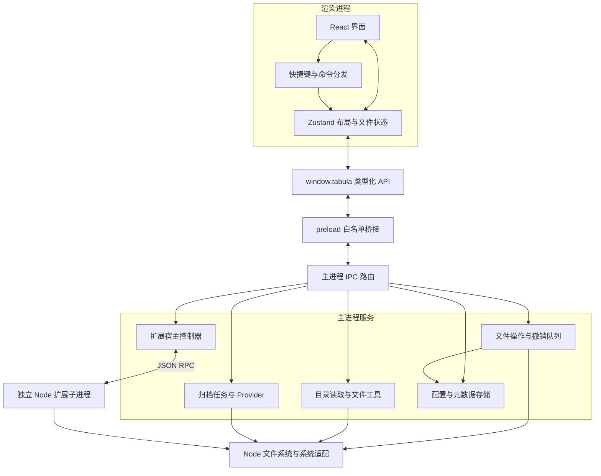
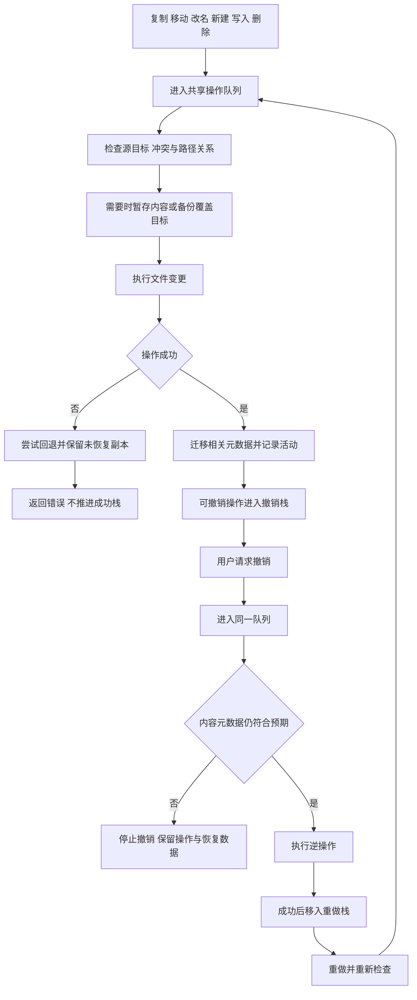

# Tabula 产品与技术设计

> 文档版本：1.1；更新日期：2026-10-28；实现基线：`0.1.0 / master / d76f7c8`。
>
> 面向产品、开发、测试及后续维护人员。本文依据当前代码与[真实进度核查](verification/project-progress-audit-2026-10-28.md)整理，描述已有实现，并明确区分能力边界、已确认缺口与后续设计；不是完整功能已验收的声明。
>
> 执行顺序和验收条件统一维护在[项目路线图](feature-roadmap.md)。本次为文档同步，没有新增产品实现或运行验收。

## 1. 产品定位与范围

Tabula 是面向本地文件整理和开发工作目录的桌面文件管理器。主要价值是把多个目录放入同一窗口，通过标签、分屏、批量操作、搜索和预览减少窗口切换。

当前产品以 Windows 本机可用性为主要验证对象。代码包含 macOS / Linux 的窗口、驱动器、回收站和终端适配，以及三个平台的安装目标；本轮没有相应跨平台运行及当前提交安装包验收。

### 1.1 典型场景

| 使用者与场景 | 需要完成的任务 | 对应能力 |
|---|---|---|
| 日常文件整理 | 同时比较两个目录，选择、移动、改名和检查文件 | 分屏、标签、多选、冲突处理、撤销 |
| 开发者管理工作区 | 快速进入项目目录，预览代码，打开终端 | 历史、收藏、地址栏、文本 / 代码预览、终端入口 |
| 文档与素材整理 | 批量统一文件名，按类型浏览，搜索内容 | 重命名规则、分组、类型筛选、Office / PDF 内容提取 |
| 存储检查 | 找出相同内容文件，统计大小，核对校验和 | 重复文件、目录统计、SHA-256 / SHA-1 / MD5 |
| 高级文件管理 | 访问已映射网络目录，管理链接和文件夹图标 | Windows SMB / NFS 入口、链接管理、图标设置 |

### 1.2 当前范围与非目标

当前范围包括本地及系统已挂载目录、核心文件操作、进程内撤销、文件预览、有限递归搜索和应用内元数据。重复文件工具只报告重复组和占用，不自动删除内容。

当前不包含全文索引、OCR、云盘 Provider、跨设备同步、系统级历史版本、加密归档、ZIP64、社区扩展市场。时间线记录应用操作，不能替代备份。`.lnk` / `.alias` 原生别名不等同于当前实现的符号链接 / 目录联接。

## 2. 功能基线

| 能力 | 当前设计与实现 | 状态 |
|---|---|---|
| 浏览与布局 | 真实标签 / 分屏已有验证；公共桥接和逐窗口持久化未完成 | 部分实现 |
| 文件列表 | List / Details / Grid、排序、分组、类型筛选、框选、反选、尺寸设置 | 已实现并验证 |
| 核心文件操作 | 复制、移动、单项 / 批量重命名、新建、写入、删除、冲突处理 | 已实现并验证 |
| 撤销 / 重做 | 核心操作共用主进程队列、备份和进程内操作栈；限本文所列范围 | 已实现并验证 |
| 搜索与判重 | 文件名搜索、按格式提取内容、大小分桶与 SHA-256 判重 | 已实现并验证 |
| 预览与归档 | 多格式预览与 ZIP / TAR / TGZ 任务；受大小、格式及解码能力限制 | 已实现并验证 |
| 元数据 | 标签、图标映射、最近 5000 条操作记录；真实系统图标效果未验收 | 已实现，环境待验收 |
| 系统互通 | 原生拖出、网络映射、系统默认应用设置入口；真实外部环境未验收 | 已实现，环境待验收 |
| 剪贴板 | 当前 renderer 保存 copy / cut 文件状态，系统写入路径文本；原生文件格式未接通 | 部分实现 |
| 插件 | 发现、Node 子进程、启动激活、直接命令调用、示例面板；存在已复现缺陷 | 部分实现 |
| 发布与平台 | 三平台 Provider、打包目标、更新接口与通知；当前版本流程未验收 | 部分实现 |

状态使用路线图统一的“已实现并验证”“已实现，环境待验收”“部分实现”“未实现”口径。上表按组合能力判断，原生剪贴板、逐窗口恢复、公共布局桥接等未实现子项在路线图单列，不能由已有 UI 推定完成。

详细逐项证据、未覆盖场景与缺陷复现见进度核查；本表不替代测试记录。

## 3. 信息架构与交互

主窗口由侧边栏、标签与窗格区、路径导航、工具栏、文件内容区和状态信息组成。侧边栏提供收藏、驱动器、扩展和访问历史；每个文件 pane 提供独立当前路径和选择状态。

### 3.1 标签与窗格

- 标签保存路径、标题、固定状态及自己的前进 / 后退历史；布局树的叶子是 pane，内部节点表示水平或垂直分屏。
- 用户可以切换、关闭、固定、复制和重排标签，跨 pane 移动标签，拖动分隔条调整比例，并将标签打开到新窗口。
- 地址栏、目录双击、搜索结果定位及后退 / 前进应通过布局导航更新活动标签，再加载相应目录，保持路径与历史一致。
- 每个窗口持有自己的运行时状态；持久化仍共用 `layoutV1`，当前没有逐窗口独立恢复协议。

当前标签与分屏由 renderer 的布局 store 实现。公共 `tabs.*` / `panes.*` 桥接尚为占位，不作为现有界面的状态来源。

### 3.2 文件列表与选择

文件数据先经过隐藏项、查询、类型筛选、排序与分组，再生成显示顺序。键盘游标、范围选择、全选和反选使用同一显示列表；框选和网格布局共用包含分组标题、列数、滚动和缩略图尺寸的布局计算。

选择区分“已选路径集合”和“当前游标路径”。批量动作读取明确选择，而非从可见 DOM 反推文件集合。空目录、加载中、读取失败和无匹配结果应分别反馈，不能把失败当成成功的空列表。

List、Details、Grid 是同一目录数据的展示方式。Details 可按名称、大小、修改时间和类型排序；类型筛选作用于当前目录，不等同于递归搜索。

### 3.3 对话框、预览与快捷键

属性、批量重命名和文件工具使用模态交互，包含焦点约束、Esc 关闭和焦点恢复。输入框、编辑态、模态和上下文菜单有各自键盘处理边界，避免文件命令在输入文字时触发。

Quick Look 从选中文件进入预览；实际快捷键由命令目录和用户绑定决定。全局键盘入口统一匹配当前 keymap，然后交给命令分发器，避免组件硬编码与可配置快捷键并存造成重复动作。

命令面板匹配内置命令的标题与标识，不提供路径结果。文件名递归搜索与“文件工具 → 全文内容搜索”是独立入口；搜索结果定位会切到父目录，并选择目标文件。

### 3.4 复制、冲突与反馈

复制 / 剪切在当前窗口保存操作模式和源路径，粘贴到目标 pane 后形成一批复制或移动计划。同名冲突提供覆盖、跳过和另取名称；解决后将明确的源 / 目标映射交给主进程。

成功后刷新受影响的目录 pane，保留未受影响的导航位置；失败显示可理解的错误。批量动作共用一条撤销记录，而非按每个文件拆成多次撤销。

当前系统剪贴板只保存路径文本，不支持与资源管理器互通原生文件复制 / 剪切，也不把不同窗口的内存剪贴板当作共享状态。

## 4. 总体架构

renderer 不直接调用 Node 文件 API，正常产品界面通过 preload 暴露的 `window.tabula` 访问主进程。扩展子进程可直接访问 Node 系统能力，因此不属于同一权限边界。

### 4.1 模块职责

| 模块 | 职责 |
|---|---|
| `apps/main` | Electron 生命周期、窗口、IPC、文件服务、撤销、Provider、配置、系统工具和扩展宿主 |
| `apps/bridge` | 跨进程数据类型、API 契约、IPC 通道名及进度事件类型 |
| `apps/renderer` | React 界面、布局与文件状态、命令派发、交互规则、预览和设置 |
| `packages/core` | 路径、MIME、ID、文件规则和 TAR 编解码等可共享逻辑 |
| `packages/ui` | 共享 UI 包；具体业务界面目前主要仍在 renderer |
| `packages/ext-api` | 扩展类型与接口声明；运行时 API 主要由宿主 context 注入 |
| `extensions` | 开发模式内置扩展，包括示例文件统计面板 |

### 4.2 IPC 与错误契约

文件操作、新工具和标签接口主要采用 `Result<T>`：成功携带 `data`，失败携带业务错误码、消息及可选路径。renderer 检查结果后更新缓存与提示，不把失败响应当成功。

配置、窗口及部分历史接口仍使用直接返回值或异常；归档也有自己的错误类型。当前没有“全部 IPC 已统一迁移”的前提，新增接口需要在桥接类型、通道、preload、主进程处理和 UI 调用之间保持一致。

归档、目录统计和扫描通过任务 ID 关联进度。工具进度可广播至多个窗口，各调用方必须按 jobId 过滤，并在关闭对话框时解绑监听和请求取消。

## 5. 状态与持久化

### 5.1 主要数据模型

| 模型 | 关键数据与用途 |
|---|---|
| `FsEntry` | 名称、路径、文件 / 目录 / 链接类型、扩展名、大小、时间和权限；作为列表与属性的基础 |
| `Tab` | ID、类型、路径 / 视图信息、标题、固定 / 可关闭状态、history 与 historyIndex |
| `LayoutNode` | pane 叶子保存 tabs 与 activeTabId；split 节点保存方向、比例和 children |
| pane 文件状态 | 当前目录、entries、已选路径、游标、查询 / 类型条件、加载 / 错误状态 |
| 文件操作请求 | sources、目标目录、可选逐项 destinations 与 overwrite / overwrites，表达冲突处理后的明确计划 |
| `UndoOperation` | 标识、显示名称、时间、do / undo / dispose 回调；栈快照不暴露回调 |
| 扫描结果 | 内容命中或重复组，以及 warnings、cancelled、truncated，避免丢失不完整扫描信息 |
| `FileActivity` | 操作名称、执行 / 撤销 / 重做阶段、路径、目标及时间，用于应用操作时间线 |

### 5.2 存储划分

| 数据 | 当前存储与生命周期 |
|---|---|
| 用户设置、布局、收藏、访问历史 | `userData` 下 `tabula-config`；布局为 `layoutV1`，变更约 200 ms 防抖写入 |
| 快捷键覆盖 | 配置中的 `shortcutsV1`，与内置目录合并为有效绑定 |
| 标签 | `tabula-tags`，整表保存路径到标签数组的映射，避免文件名中的点被解释为嵌套键 |
| 文件夹图标 | `tabula-folder-icons`，保存图像数据和还原所需的原始 desktop.ini 信息 |
| 文件操作时间线 | `tabula-activity`，最近 5000 条事件，可按文件或目录筛选 |
| 撤销闭包与运行时任务 | 内存；不跨进程恢复，不随应用重启还原 |
| 撤销备份 | `userData/undo/进程与启动时间/`，按操作创建独立备份位置 |
| 网络连接密码 | 当前对话框内存；连接后清空，不写入配置 |

路径是当前元数据的主要标识，不是稳定文件 ID。由应用执行移动 / 重命名时迁移标签和文件夹图标；外部工具改名不会自动获得同等元数据迁移保证。时间线、撤销和访问历史分别服务审计、恢复和导航，不能相互替代。

### 5.3 目录加载一致性

pane 先同步建立状态外壳，再发起异步目录读取。每个 pane 的请求有独立序号，只有最新请求可以提交结果，避免慢请求覆盖用户刚进入的新目录。

刷新也需要检查路径和请求有效性。已有交互状态不能由较晚返回的初始化请求重置。导航最终同时更新活动标签的路径与历史、pane 当前目录及相应访问记录。

## 6. 文件操作、安全回退与撤销

核心可变更操作统一经过主进程 `FileOperations`，由同一 `UndoManager` 队列串行执行。该队列也用于撤销、重做及不可撤销删除，降低应用内部操作互相穿插的风险。

此流程表示应用层的受控操作与回退，不提供跨文件系统数据库事务或进程崩溃后的自动重放。

### 6.1 复制与移动

renderer 先处理用户可见冲突，主进程仍再次校验，默认不覆盖。操作检查重复目标、源目标相同、目录互相包含等关系；先写入私有临时名称，再发布至最终目标，必要时将原目标移入备份。

移动优先使用文件系统 rename；只有 `EXDEV` 才降级为复制后删除，不把权限或其他错误误判为跨盘。失败时回退已经完成的步骤；如果源文件与临时副本同时存在等情况无法可靠恢复，应保留数据并返回位置，供用户检查。

### 6.2 批量重命名

规则层支持查找替换、前后缀、`{name}` / `{n}` / `{ext}` 模板、编号起点 / 步长 / 补零和大小写，并先给出预览。规则生成名称不承担最终文件系统安全校验。

执行层拒绝重复源、重复目标、跨目录改名、同时改名父目录与子项及占用冲突。先将所有源文件移至临时名，再依次设置最终名称，支持名称链和交换；失败时先腾空已写入的最终名，再恢复原名，避免按顺序覆盖后续源。

一批重命名作为一个撤销单元，元数据从同一映射快照迁移，避免循环映射相互覆盖。

### 6.3 删除与恢复

移入回收站前保存应用备份，之后调用系统回收站接口；撤销从应用备份恢复。恢复不会移除系统回收站中的那份副本，因此不是“回收站还原”的同一语义。

永久删除进入共享队列，但不进入可撤销栈。归档、权限、标签设置、图标、链接工具和网络设置也不属于当前核心撤销范围。

撤销使用文件树元数据指纹检查后续改动，避免直接擦除已修改的目标。指纹不是全内容哈希或外部文件锁，不能消除所有外部并发变化。

### 6.4 操作栈与备份寿命

当前使用 callback 形式的 `UndoManager`，默认最多 100 条。新操作成功后清理 redo；失败不清空 redo，也不把失败操作压成成功历史。撤销 / 重做自身失败时保留对应栈位置。

淘汰历史和正常退出时清理相关备份；恢复失败的副本保留用于人工处理。旧的数据驱动撤销 API 仍在源文件中，但实际核心 IPC 使用 callback 管理器，不应在新流程中混用两套状态。

## 7. 搜索、预览与后台工具

### 7.1 内容搜索与重复文件

内容搜索由主进程递归遍历目录，跳过符号链接；文本按编码读取，DOCX / PPTX / ODT 提取 XML，表格经 xlsx 提取，文本型 PDF 经 PDF.js 提取。返回文件、行号和片段；表格行号指提取文本行号，不是统一的原始工作表坐标。

默认深度 64，深度参数最多 256；最多扫描 100000 项、返回 5000 处内容命中，每文件最多 10 处。内容单文件上限 32 MB，PDF 最多提取 1000 页；这些上限不构成对压缩文档解码时峰值内存的完整保证。

重复文件先按大小分桶，再对候选流式计算 SHA-256，并检查读取前后的大小和修改时间。扫描与散列阶段提供进度和取消；扫描范围有上限，不应声称找到整台设备的全部重复文件。

扫描结果保留取消、不完整和读取失败信息。当前取消主要发生在遍历、文件处理之间或流式读取边界；单个格式解析中的同步工作未必立即中断。未来如面向大目录，应考虑独立 worker、工作量预算和索引服务。

### 7.2 文件预览

renderer 按扩展名分发预览器，未知无扩展名文件可嗅探文本。Office、PDF 和归档依赖按格式处理；音视频依赖 Electron 解码器，分类识别不能保证任意编码可播放。

| 类型 | 当前读取 / 显示限制 |
|---|---|
| 文本、代码、Markdown | 超过 1 MB 截断到 100 行；超过 5 MB 拒绝预览；先读取文件再截断 |
| 图片 | 5 MB 上限 |
| 音视频 | 500 MB 上限 |
| PDF | 100 MB 上限 |
| 字体 | 20 MB 上限 |
| DOCX | 50 MB 上限 |
| XLSX / PPTX | 100 MB 上限 |
| 归档 | 1 GB 输入上限；解压内存仍需单独约束 |

二进制预览当前从 IPC 获得完整 ArrayBuffer，生成 Blob URL 后交给组件；不是通过本地协议进行区间流式加载。预览异步结果需要在关闭或切换文件后忽略，生命周期结束时回收相关资源。

RTF 由主进程使用回调包装转换器解析，再返回用于预览的内容；不把需要 Node 的转换器放入 renderer。Markdown、Office 和 RTF 等生成 HTML 的路径仍应持续检查内容清理与资源加载边界。

### 7.3 归档

归档路由按文件名选择 ZIP 或独立 TAR Provider；`.tar.gz` 按 TGZ 路由。TAR 支持 USTAR、PAX 与 GNU 长文件名解析，TGZ 先解 gzip。任务使用 ID、阶段、处理进度、错误和取消状态；终态保留一段时间供界面查询。

解压前检查条目名称、输出路径、重复目标、占用冲突和符号链接路径，避免归档条目写出目标目录。压缩目标已存在时返回冲突。TAR 压缩原始数据及读取的归档输入有 1 GB 检查，但解 gzip / 解析仍在内存完成，不能视作对所有展开大小的硬性控制。

归档任务不进入核心撤销栈。取消或中途错误不承诺恢复已经写出的全部文件；后续如需原子解压，应增加临时输出目录和最终发布步骤。

### 7.4 系统工具

SMB / NFS 工具使用 Windows 系统命令映射目录，并只管理当前会话由本应用创建的映射。NFS 采用系统客户端的匿名挂载配置；连接成功后通过普通目录浏览访问网络盘。真实服务器连通性尚待验收。

链接工具使用真实文件系统链接；硬链接限同卷文件，目录在 Windows 使用 junction。改写符号链接目标先创建临时链接并备份原链接，失败时尝试恢复。

文件夹图标在应用内使用持久化图像，Windows 另写 ICO / desktop.ini 并保留原配置用于重置；系统缓存刷新尚未实测。默认应用工具按扩展名打开 Windows 系统设置，由用户在系统页面选择确认，不直接管理注册表关联。

## 8. 插件与信任边界

### 8.1 已有机制

插件发现器扫描开发模式内置目录及用户目录的 `package.json`，用 `name` 标识扩展。当前加载入口为 CommonJS，通过独立 Node 子进程执行 `activate(context)`；主进程与子进程通过逐行 JSON RPC 通信。

context 提供命令注册、面板注册、工作区读取和面板数据推送等能力。示例扩展注册统计命令，读取目录并向 renderer 推送结构化数据，现有面板展示该结果。

插件可以直接 require Node 模块。独立进程可隔开 UI 执行现场，却没有限制扩展访问操作系统和文件系统；renderer 的 contextIsolation 也不为插件提供权限隔离。

### 8.2 已确认缺口

- `onStartup` 已接通；`onCommand` 的实际命令调用不触发激活，本轮已复现 `Command not found`；`onFileSystem` 只有匹配代码。
- 插件禁用后重新启用没有恢复激活，本轮已复现；启用成功响应不能等同于命令可用。
- 扩展注册的命令没有完整并入内置命令目录，配置、预览器、视图、快捷键等贡献点未全部贯通。
- API 包的同名运行时导出仍为占位，不能代替注入的 context。
- 生产发现位置与当前打包资源规则没有完整对齐，需验证内置扩展在安装包中的存在与加载。

### 8.3 后续设计方向

先修复激活状态机和事件路由，明确 enabled、loaded、activated、failed 的差别；命令执行前按归属触发激活，启用后按当前策略重新激活，并覆盖卸载和进程退出清理。

扩展信任模型需要单独决策：若继续运行完整 Node 扩展，应明确采用受信任本地插件模型；若开放不受信任市场，需要额外权限和隔离方案。当前文档不预设已经具备该方案。

贡献点应在宿主、命令目录和 renderer 之间形成可查询、可注销的统一注册生命周期；扩展市场及在线安装放在这些基础能力验收之后。

## 9. 平台、生命周期与发布

启动流程依次初始化日志与单实例锁、等待 Electron ready、创建启动屏、读取配置、发现并初始化扩展、创建主窗口、注册 IPC 和快捷键，再加载 renderer 与恢复布局。扩展初始化当前处于主窗口创建之前，会影响启动路径。

窗口设置使用 contextIsolation，关闭 renderer 的 Node 集成；当前 `sandbox: false`，preload 是可信代码。外部 URL 和窗口打开交由系统处理。新系统工具应继续使用明确参数调用，避免把文件名、共享名和凭据拼成通用 shell 文本。

关闭应用时等待核心文件队列及备份释放；这属于正常退出处理，不能视为异常崩溃后的恢复协议。驱动器、回收站、窗口和终端由平台 Provider 隔离，网络映射及默认应用工具目前主要是 Windows 实现。

electron-vite 分别构建 main、preload 和 renderer，并生成扩展宿主脚本。main 使用单包输出，避免特定延迟加载分块重新触发入口初始化；PDF.js 保持外部动态加载。

electron-builder 配置包含 Windows NSIS x64、macOS DMG x64 / arm64、Linux AppImage / deb。本机存在历史 Windows 包，本轮未重新打包或安装。签名、发布源、更新下载与安装、跨平台运行必须分别验收；不能从配置存在推断发布链路完成。

自动更新代码与通知 UI 存在，但启动自动检查已注释；非安装包环境的手动检查会进入 disabled。当前没有可核实的最新版本更新闭环。

## 10. 质量要求与现有证据

| 维度 | 已有证据 | 后续验收要求 |
|---|---|---|
| 规则与回归 | 42 个测试文件、370 项通过；含文件操作、元数据、归档、状态和 React 交互 | 新缺陷先补能复现实际行为的回归，避免只验证 mock 调用 |
| 类型与构建 | strict 类型检查和三部分正式构建通过 | 主进程格式解析与预览应在正式产物中抽检，不能只跑源码单测 |
| Windows 运行 | 本轮 6 项正向检查成功；两项插件缺陷复现 | 原生剪贴板、外部拖拽、回收站错误路径、网络盘和图标效果单独验收 |
| 性能 | 虚拟列表、模块懒加载、进度与内存采样已有实现 | 建立目录规模、启动耗时、峰值内存、任务取消延迟与长时间运行基准 |
| 可恢复性 | 事务回退、覆盖备份、撤销栈、元数据指纹有测试 | 验证磁盘满、断开网络盘、外部修改、回退失败和异常退出，说明恢复范围 |
| 平台与发布 | Provider 与打包目标存在 | 当前 Windows 包安装 / 升级；macOS / Linux 实机；签名与更新发布 |

当前测试不是所有能力验收完成的证明。系统适配中的网络、图标和默认应用测试使用受控替身；React 测试也替换桥接或布局测量。运行记录应保存基线提交、实际场景、环境与限制，避免把“问题按预期复现”统计为功能可用。

## 11. 已知风险与演进顺序

| 顺序 | 工作 | 可验收的结果 |
|---|---|---|
| 1 | 修复插件按需激活、重新启用与清理；补齐贡献点，明确本地插件信任模型 | 真实插件完成启动、禁用、启用、命令触发和卸载；贡献点注册、使用和注销一致 |
| 2 | 补齐 Windows 系统互通 | 与资源管理器原生文件复制 / 剪切互通；外部应用多文件拖入；回收站错误不再伪装空列表；真实 SMB / NFS 场景 |
| 3 | 当前版本 Windows 发布验收 | 明确提交对应安装包，完成安装、启动、关键文件操作、升级 / 卸载及内置扩展检查 |
| 4 | 布局与元数据一致性 | 决定公共 tabs / panes 接口的实现或收敛方式；逐窗口会话隔离；外部路径变更策略与配置迁移 |
| 5 | 性能、跨平台与发布更新 | 目录 / 文件规模与资源预算基准、三平台验收矩阵、签名 / 发布源与更新失败处理证据分别记录 |

上述五步与[项目路线图](feature-roadmap.md)一致，具体工作和验收条件以路线图为执行入口，不承诺日期。文档站与社区扩展市场为未实现，暂不纳入五步排期。性能、跨平台和更新发布各自保留验收结果，不能合并为一个完成标记。

## 12. 维护与参考

文档中的“当前”固定对应开头的实现基线。后续改变操作边界、元数据模型、平台能力或插件信任模型时，应同时更新本文、路线图和验证记录；历史报告保留原结论及对应提交。

- [真实进度核查](verification/project-progress-audit-2026-10-28.md)：本次重新验证、已确认缺陷与全项目状态。
- [Feature Roadmap](feature-roadmap.md)：原始 28 行 / 26 个独立条目的范围、统一状态与全项目五步执行计划。
- [路线图修复前核查](verification/feature-roadmap-audit-2026-10-28.md)：保留修复前问题与复现证据。
- [路线图实现与验证](verification/feature-roadmap-implementation-2026-10-28.md)：新增功能、修复及已有桌面验证记录。
- [README](../README.md)：开发入口、当前功能说明与阶段状态。
